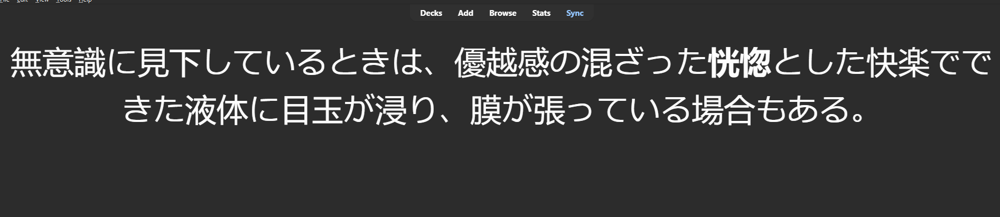
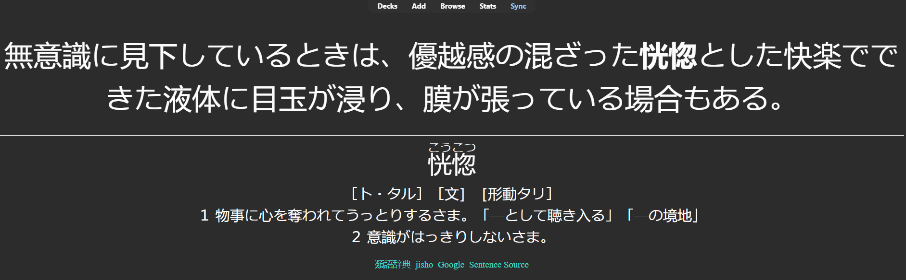
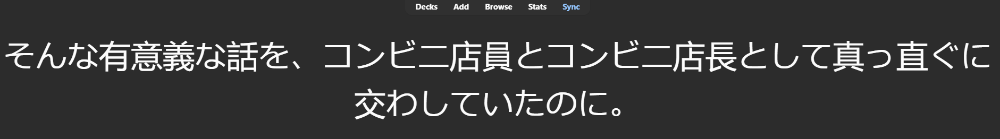
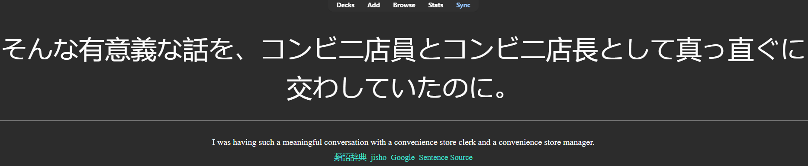
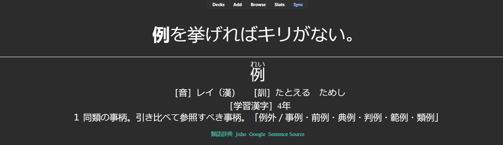

# Anki-Notes-Creator

## Description:
Word/sentence miner for Anki.
Automatically creates complete and well structured cards for japanese vocabulary in Anki.  **Using just the desired word or a whole sentence**, the notes are created with the word and an example sentence on the front, and the translation the back, along with the pronunciation of the desired word and links to online dictionaries for further study.

### Example usage:  
無意識に見下しているときは、優越感の混ざった(恍惚)とした快楽でできた液体に目玉が浸り、膜が張っている場合もある。
gets converted to the following Anki card:



そんな有意義な話を、コンビニ店員とコンビニ店長として真っ直ぐに交わしていたのに。
gets converted to the following Anki card:



例
gets converted to the following Anki card:



### Requirements:

You need to have Anki installed, Anki-Connect and the resources in requirements.txt.

To install Anki:
https://apps.ankiweb.net/

To install Anki-Connect:
https://foosoft.net/projects/anki-connect/

### How to use:

With Anki open, double click on "card_model.apkg" to import the necessary card model into anki. The deck can be deleted after importing; it only serves to create a correct card template.  
Run ``` pip install -r /path/to/requirements.txt ``` to install the necessary libraries.  
Next, run the "main.py" file. It will create a test deck "test1" and add the words from the "add_words.txt" file as cards.
To add your words to your deck, simply change the "deck_name" variable to the name of your deck and add the words or sentences to the "add_words.txt" file in one of the following formats:
- Word
Creates a card with the word, an example sentence containing the word from a database, and the translation of the word.
- Simple sentence
Creates a card with the sentence and its translation.
- Sentence with (word)
Creates a card with the sentence and the word, along with the translation of the word.

### Notes:

The "add_words.txt" file should be formatted as follows:
```txt
例
そんな有意義な話を、コンビニ店員とコンビニ店長として真っ直ぐに交わしていたのに。
無意識に見下しているときは、優越感の混ざった(恍惚)とした快楽でできた液体に目玉が浸り、膜が張っている場合もある。
...
```

### Contributions:

Contributions are welcome! The project still have tons of features to add, so feel free to open issues or submit pull requests.